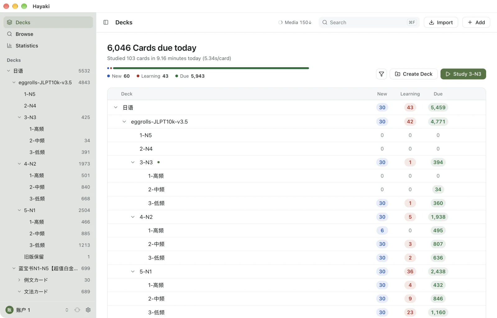
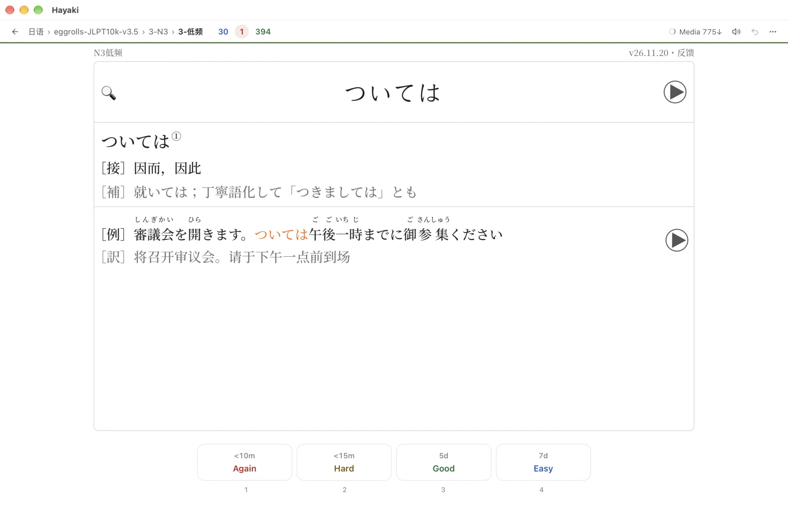
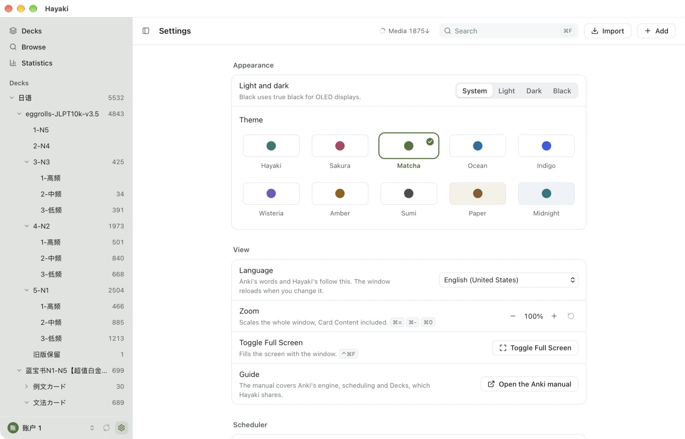
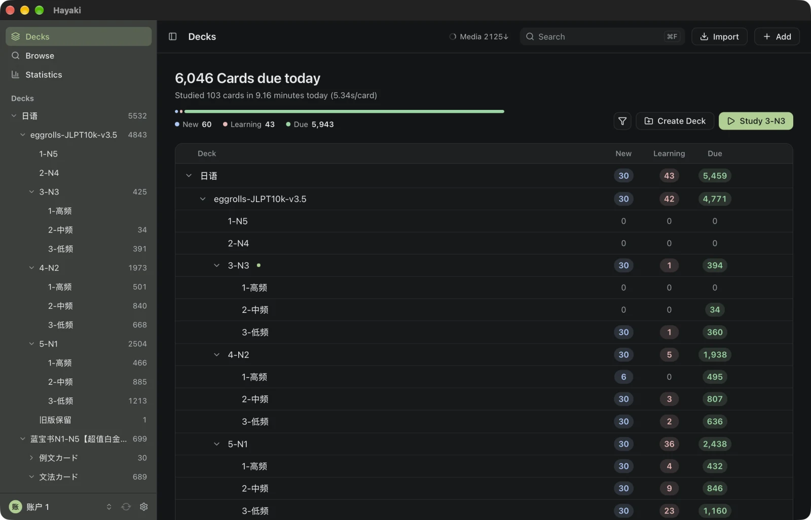

<p align="center">
  
</p>

<h1 align="center">Hayaki for desktop</h1>

<p align="center">
  <b>A calm, fast desktop app for your Anki collection.</b><br>
  Anki's own engine, a new interface. Windows, macOS and Linux.
</p>

<p align="center">
  <b>English</b> · <a href="README.zh-CN.md">简体中文</a>
</p>

<p align="center">
  <a href="LICENSE"></a>
  
  
  
  
  
  <a href="https://github.com/amemiya02/Hayaki-Desktop/commits/main"></a>
  <a href="https://github.com/amemiya02/Hayaki-Desktop/stargazers"></a>
</p>

<p align="center">
  <picture>
    <source media="(prefers-color-scheme: dark)" srcset="docs/screenshots/decks-dark.webp">
    
  </picture>
</p>

Hayaki rebuilds Anki Desktop's interface from scratch, in one design system, on top of Anki's unmodified Rust engine. Scheduling, search, storage and sync are upstream's own code, so your collection moves freely between Hayaki, Anki, AnkiDroid and the [Android](https://github.com/amemiya02/Hayaki) and [iOS](https://github.com/amemiya02/Hayaki-iOS) editions.

## Screenshots

<table>
  <tr>
    <td width="50%"></td>
    <td width="50%"></td>
  </tr>
  <tr>
    <td align="center"><sub>Study, with Card Templates rendered untouched</sub></td>
    <td align="center"><sub>Browse, with the editor beside the table</sub></td>
  </tr>
  <tr>
    <td width="50%"></td>
    <td width="50%"></td>
  </tr>
  <tr>
    <td align="center"><sub>Statistics, drawn natively from the engine's numbers</sub></td>
    <td align="center"><sub>Ten themes, light, dark and true black</sub></td>
  </tr>
  <tr>
    <td width="50%"></td>
    <td width="50%"></td>
  </tr>
  <tr>
    <td align="center" colspan="2"><sub>Dark mode</sub></td>
  </tr>
</table>

## Features

- **Study** with the v3 scheduler, FSRS or SM-2, exactly as upstream. Audio, text-to-speech, type-in answers, MathJax, timers, auto advance, flags, marks, bury, suspend, set due, undo and redo, with Anki's shortcuts.
- **Browse** large collections in a virtualized table with Anki's search syntax, sidebar filters, Find and Replace, Find Duplicates, Grade Now and bulk actions.
- **Add and edit** in a rich-text editor with cloze shortcuts, MathJax preview, image resizing, media paste and drop, recording, sticky fields and tag autocomplete.
- **Deck Options and Statistics**, rebuilt natively, including FSRS optimize, evaluate and the simulator.
- **Collection tools:** Note Types and Card Templates with a live preview, Change Note Type, Filtered Decks, Custom Study, Image Occlusion, CSV, `.apkg` and `.colpkg` import and export, Check Database, Check Media and Empty Cards.
- **Sync** with AnkiWeb or a self-hosted server, automatically on open and close, with media progress and a media log.
- **Automatic backups** and restore from any backup.
- **Plugins** in JavaScript, each in its own sandbox with the permissions you approve at install: commands, sidebar panels, review events and Card styling. See [docs/plugins.md](docs/plugins.md).
- **AnkiConnect, built in.** Turn it on in Settings, and Yomitan, browser extensions and scripts can add notes. Only programs on your computer can connect, and web pages must be allowed one by one.
- **Feels native.** Mica on Windows 11, vibrancy on macOS, ⌘ shortcuts on the Mac, zoom, full screen, a command palette (Ctrl+K / ⌘K) and a shortcuts sheet (`?`).
- **English, Simplified Chinese and Japanese** throughout, and every language Anki itself translates.

## Build from source

You need [rustup](https://rustup.rs) (the pinned Rust toolchain installs itself), Node.js 22+, the [Tauri prerequisites](https://tauri.app/start/prerequisites/) for your platform and `protoc` 3.15+.

```sh
git clone --recurse-submodules https://github.com/amemiya02/Hayaki-Desktop.git
cd Hayaki-Desktop
git -C vendor/anki submodule update --init --depth 1 ftl/core-repo ftl/qt-repo
npm install

# Name Hayaki's build in the sync requests the core sends
mkdir -p vendor/anki/out && printf 'hayaki-%s' "$(git -C vendor/anki rev-parse --short=8 HEAD)" > vendor/anki/out/buildhash

export PROTOC=/path/to/protoc
export DESCRIPTORS_BIN="$PWD/build/core/descriptors.bin"

(cd src-tauri && cargo build)   # the first build compiles Anki's core and takes a while
npm run core:gen                # typed TypeScript calls for every core method
npm run app                     # run in development mode
```

`npm run app:build` writes installers to `src-tauri/target/release/bundle/`. Run the tests with `npm test`, `npm run typecheck` and `cargo test --lib` in `src-tauri`.

## How it works

```
React 19 interface
   │  typed calls, generated from the engine's own descriptors
   ▼
one Tauri command      protobuf in, protobuf out
   │
   ▼
Anki's Rust engine     vendor/anki 26.09.4, unmodified
```

- [`vendor/anki`](vendor/anki) is upstream Anki at `26.09.4`, linked as Rust path dependencies.
- [`src-tauri/src/core.rs`](src-tauri/src/core.rs) is the whole bridge: it runs a core method by number and returns the encoded reply.
- Card Content renders on a separate origin, so scripts in Card Templates can never reach the engine or the interface.
- The interface uses React 19, TypeScript, Tailwind CSS 4, Radix and TanStack Query.

Design decisions live in [`docs/adr/`](docs/adr/) and product rules in [PRODUCT.md](PRODUCT.md).

## Contributing

Bug reports and ideas are welcome in [Issues](https://github.com/amemiya02/Hayaki-Desktop/issues). Please include your platform and the steps that show the problem.

## License

[AGPL-3.0-or-later](LICENSE). Hayaki embeds Anki (© Ankitects Pty Ltd and contributors, AGPL-3.0-or-later) and MathJax (Apache-2.0). Hayaki is an independent project, not affiliated with Ankitects.
