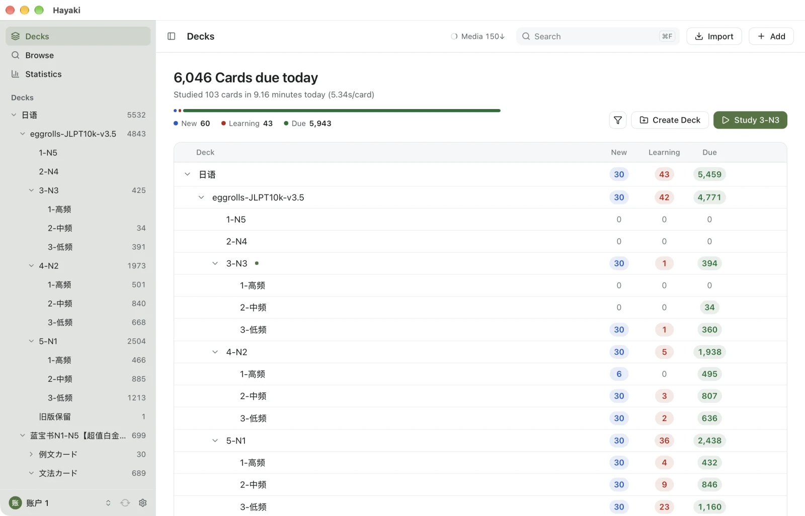
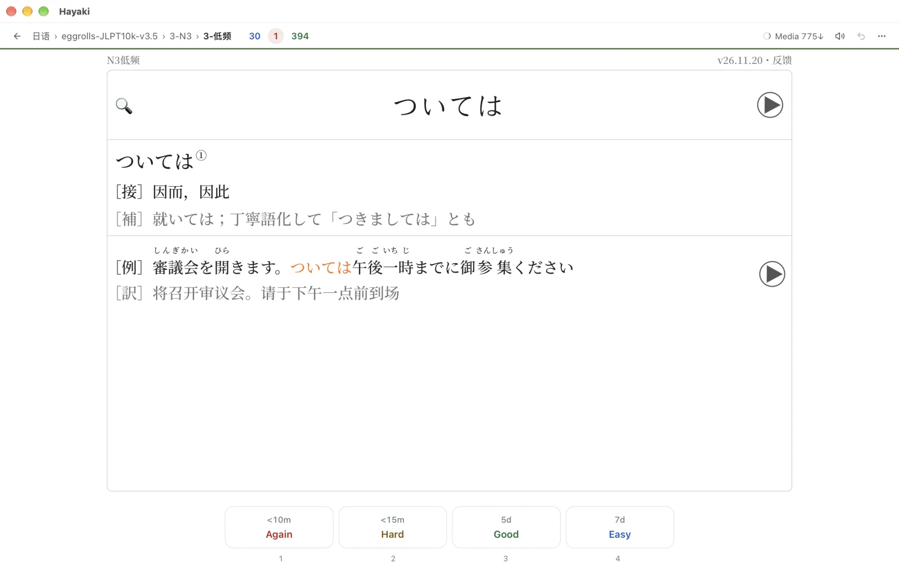
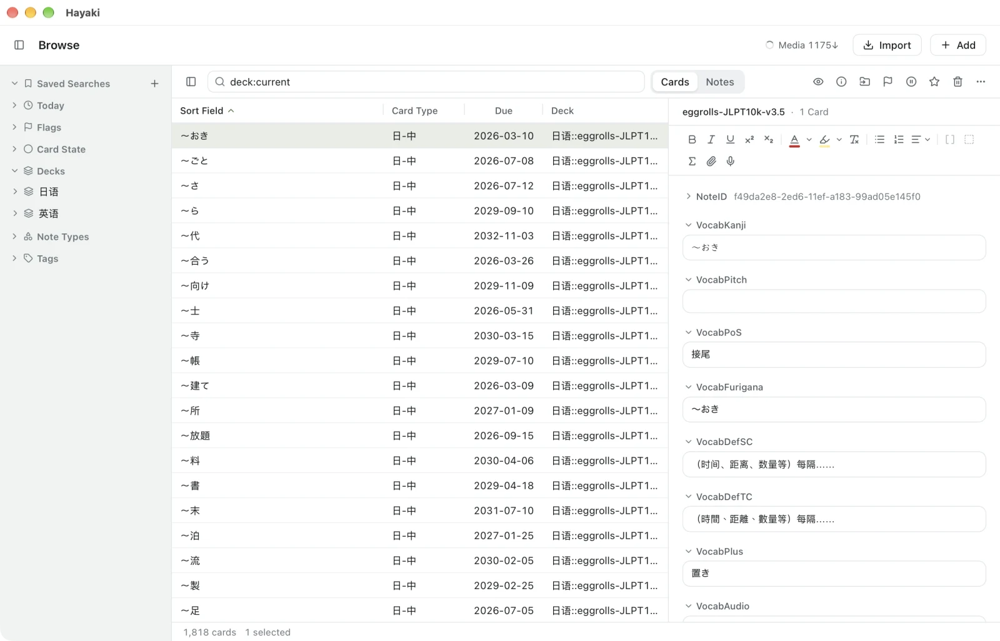
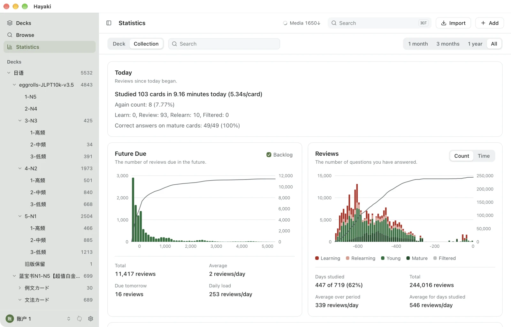
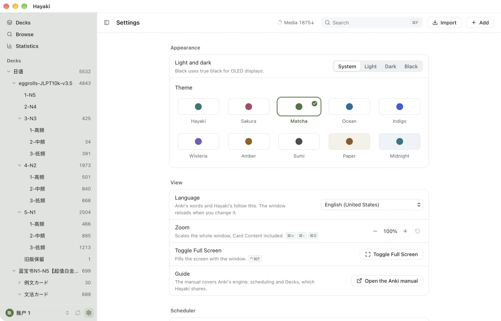
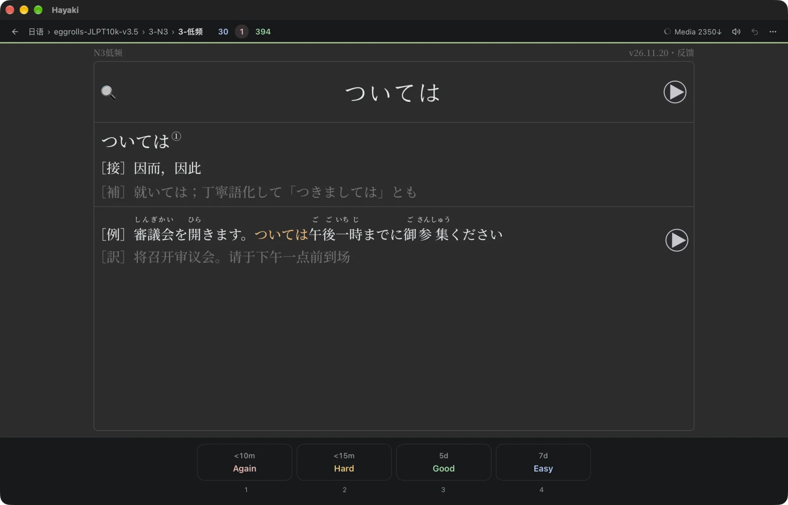
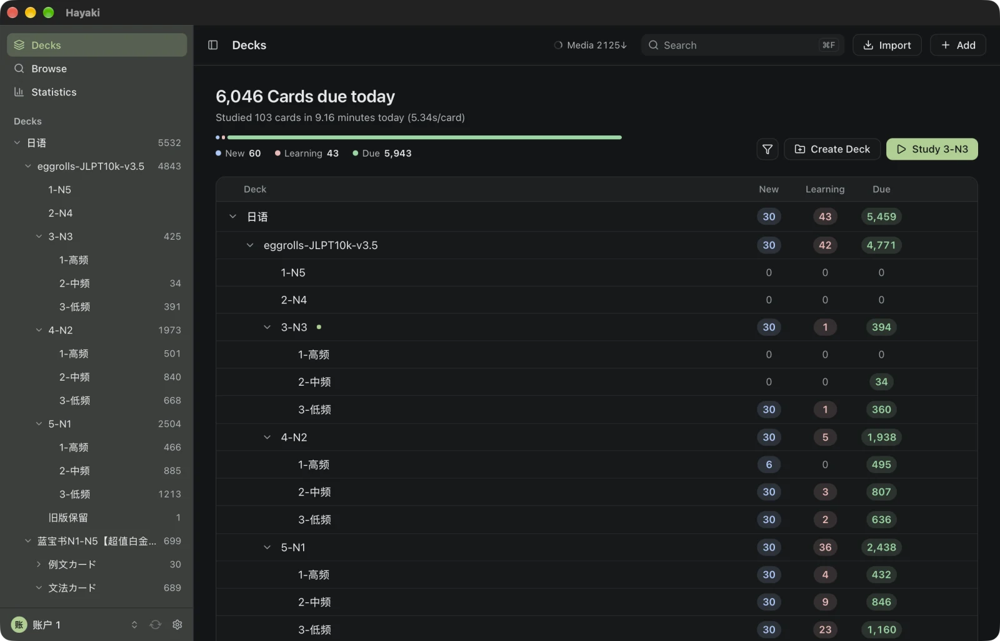

<p align="center">
  
</p>

<h1 align="center">Hayaki 桌面版</h1>

<p align="center">
  <b>为你的 Anki 卡组打造的安静、快速的桌面应用。</b><br>
  Anki 原版引擎，全新界面。支持 Windows、macOS 和 Linux。
</p>

<p align="center">
  <a href="README.md">English</a> · <b>简体中文</b>
</p>

<p align="center">
  <a href="LICENSE"></a>
  
  
  
  
  
  <a href="https://github.com/amemiya02/Hayaki-Desktop/commits/main"></a>
  <a href="https://github.com/amemiya02/Hayaki-Desktop/stargazers"></a>
</p>

<p align="center">
  <picture>
    <source media="(prefers-color-scheme: dark)" srcset="docs/screenshots/decks-dark.webp">
    
  </picture>
</p>

Hayaki 用一套统一的设计系统，从零重写了 Anki 桌面版的界面，底层是未经修改的 Anki Rust 引擎。排程、搜索、存储和同步都直接使用上游代码，所以你的卡组可以在 Hayaki、Anki、AnkiDroid 以及 Hayaki 的 [Android](https://github.com/amemiya02/Hayaki) 和 [iOS](https://github.com/amemiya02/Hayaki-iOS) 版之间随意切换。

## 截图

<table>
  <tr>
    <td width="50%"></td>
    <td width="50%"></td>
  </tr>
  <tr>
    <td align="center"><sub>学习：卡片模板原样渲染</sub></td>
    <td align="center"><sub>浏览：编辑器就在表格旁边</sub></td>
  </tr>
  <tr>
    <td width="50%"></td>
    <td width="50%"></td>
  </tr>
  <tr>
    <td align="center"><sub>统计：直接用引擎的数据原生绘制</sub></td>
    <td align="center"><sub>十种主题，支持浅色、深色和纯黑</sub></td>
  </tr>
  <tr>
    <td width="50%"></td>
    <td width="50%"></td>
  </tr>
  <tr>
    <td align="center" colspan="2"><sub>深色模式</sub></td>
  </tr>
</table>

<sub>截图为英文界面。应用会跟随系统语言，也可以在设置里切换。</sub>

## 功能

- **学习**：v3 排程器，FSRS 或 SM-2，行为与上游完全一致。支持音频、文字转语音、输入答案、MathJax、计时器、自动翻页、旗标、标记、搁置、暂停、设置到期日、撤销与重做，快捷键与 Anki 相同。
- **浏览**：虚拟化表格，应对大型卡组也很流畅。支持 Anki 搜索语法、侧边栏筛选、查找替换、查找重复、立即评分和批量操作。
- **添加与编辑**：富文本编辑器，支持挖空快捷键、MathJax 预览、图片缩放、粘贴与拖放媒体、录音、固定字段和标签自动补全。
- **牌组选项与统计**：原生重写，包括 FSRS 优化、评估和模拟器。
- **卡组工具**：笔记模板和卡片模板（带实时预览）、更改笔记模板、筛选牌组、自定义学习、图片遮盖，导入导出 CSV、`.apkg` 和 `.colpkg`，检查数据库、检查媒体和清空空白卡片。
- **同步**：支持 AnkiWeb 或自建同步服务器，可在打开和关闭时自动同步，并显示媒体同步进度和日志。
- **自动备份**，可以从任意备份恢复。
- **内置 AnkiConnect**：在设置中开启后，Yomitan、浏览器扩展和脚本就能添加笔记。只有本机程序可以连接，网页需要逐个授权。
- **原生体验**：Windows 11 的 Mica 和 macOS 的毛玻璃效果，Mac 上显示 ⌘ 快捷键，支持缩放、全屏、命令面板（Ctrl+K / ⌘K）和快捷键一览（`?`）。
- **简体中文、日语和英语**全面支持，Anki 自身翻译过的语言也都可以使用。

## 从源码构建

你需要 [rustup](https://rustup.rs)（会自动安装项目固定的 Rust 工具链）、Node.js 22+、对应平台的 [Tauri 依赖](https://tauri.app/start/prerequisites/)，以及 `protoc` 3.15+。

```sh
git clone --recurse-submodules https://github.com/amemiya02/Hayaki-Desktop.git
cd Hayaki-Desktop
git -C vendor/anki submodule update --init --depth 1 ftl/core-repo ftl/qt-repo
npm install

# 在引擎发出的同步请求中标明 Hayaki 的构建版本
mkdir -p vendor/anki/out && printf 'hayaki-%s' "$(git -C vendor/anki rev-parse --short=8 HEAD)" > vendor/anki/out/buildhash

export PROTOC=/path/to/protoc
export DESCRIPTORS_BIN="$PWD/build/core/descriptors.bin"

(cd src-tauri && cargo build)   # 首次构建会编译 Anki 引擎，需要一些时间
npm run core:gen                # 为每个引擎方法生成带类型的 TypeScript 调用
npm run app                     # 以开发模式运行
```

`npm run app:build` 会把安装包输出到 `src-tauri/target/release/bundle/`。测试命令是 `npm test`、`npm run typecheck`，以及在 `src-tauri` 下运行 `cargo test --lib`。

## 工作原理

```
React 19 界面
   │  类型化调用，根据引擎自己的描述文件生成
   ▼
一个 Tauri 命令    收发 protobuf
   │
   ▼
Anki Rust 引擎     vendor/anki 26.09.4，未修改
```

- [`vendor/anki`](vendor/anki) 是上游 Anki `26.09.4`，以 Rust 路径依赖的方式链接。
- [`src-tauri/src/core.rs`](src-tauri/src/core.rs) 就是全部的桥接层：按编号调用引擎方法，返回编码后的结果。
- 卡片内容在独立的源中渲染，所以卡片模板里的脚本永远无法访问引擎或界面。
- 界面使用 React 19、TypeScript、Tailwind CSS 4、Radix 和 TanStack Query。

设计决策记录在 [`docs/adr/`](docs/adr/)，产品规则见 [PRODUCT.md](PRODUCT.md)。

## 参与贡献

欢迎在 [Issues](https://github.com/amemiya02/Hayaki-Desktop/issues) 反馈问题或提出想法。请注明你的平台和复现步骤。

## 许可证

[AGPL-3.0-or-later](LICENSE)。Hayaki 内嵌了 Anki（© Ankitects Pty Ltd 及贡献者，AGPL-3.0-or-later）和 MathJax（Apache-2.0）。Hayaki 是独立项目，与 Ankitects 无关。
